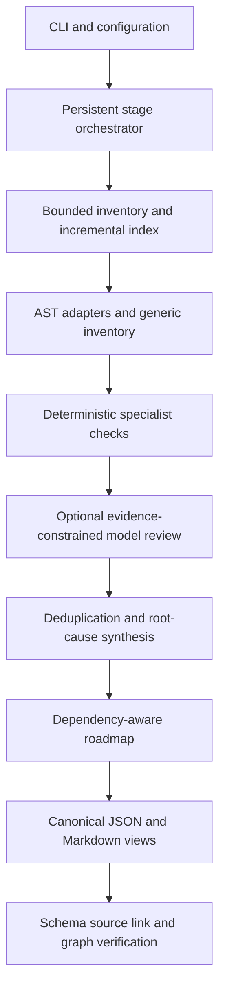

# Architecture

Codebase Intel is a standalone TypeScript/Node.js CLI. Structured findings form the canonical layer; Markdown is a derived view. The default lifecycle is ANALYZE_ONLY.

## Contracts and boundaries

`schema.ts` defines validated configuration and full finding records. File records contain paths, hashes, language, classification, ownership, symbols, imports, exports, references, parser errors and test/configuration relationships. The index contains local dependency edges, technology evidence and a machine-readable coverage ledger.

`safety.ts` constrains relative paths, rejects symlink ancestors, bounds file reads, redacts common credential patterns and atomically writes owned output. Target source is untrusted data. Repository instructions, package scripts and generated prose do not become governing instructions.

`tools.ts` exposes a fixed subprocess registry. Git operations collect read-only metadata with external configuration disabled. Python runs an isolated AST helper over stdin; it does not import or execute target modules. TypeScript uses its bundled syntax API without executing target compiler plugins or configuration code.

## Analysis and retrieval

`adapters.ts` implements a registry with JavaScript/TypeScript, Python and generic adapters. Adapters advertise their language/version boundaries, available checks, official reference entry points and test strategies. Additional languages require an actual parser/check implementation and contract tests before their semantic support is claimed.

`analysis.ts` combines per-file rules with local import-cycle detection, manifest constraints, test-association heuristics, credential-shaped literal checks and token-identical JavaScript/TypeScript function blocks. It uses iterative graph traversal to avoid import-chain recursion limits. It does not perform global type inference, taint analysis or runtime profiling.

`retrieval.ts` supports exact symbols, path filters, keyword windows and dependency-related file expansion within a character-based context budget. Source hashes are checked before context is packaged. No vector database is required. Indexing reads bounded repository content; model context receives selected pieces rather than the entire tree.

## Models

`models.ts` implements ordinary documented HTTP request families for Chat Completions compatible servers, Anthropic Messages, Gemini generateContent and Ollama chat. The provider and model ID are configuration, not hardcoded assumptions about available reasoning capability.

Model access requires explicit source-sharing, network and exact-origin permission. Credentials are selected by environment-variable name. Responses must satisfy a structured schema and cite exact redacted source lines from the supplied context. Accepted suggestions remain HYPOTHESIS. Retry attempts count against the persistent call budget. Provider errors preserve the deterministic audit and expose bounded diagnostics without response bodies or credential values.

## Synthesis and planning

`planner.ts` deduplicates findings, groups shared rule signatures into root-cause hypotheses, links related issues, and flags potential safety/performance interactions in neighboring source ranges. It reconciles specialist document IDs with canonical records before planning. This is deterministic cross-record synthesis, not a claim to resolve all semantic contradictions automatically.

The planner creates stable baseline, remediation and hardening tasks. Conservative phase barriers and finding prerequisites produce an acyclic ordered graph; parallel groups indicate dependency readiness and still require checking shared-file overlap. Each task includes affected evidence, implementation steps, tests, benchmark requirements, rollback and completion criteria.

`reports.ts` renders the audit tree from canonical records. Evidence is source-linked and redacted; Mermaid diagrams use generated identifiers rather than untrusted source text. Non-applicable or unsupported areas are recorded explicitly. Documents do not invent business invariants, dynamic behavior or measured speed improvements.

## Persistence and extension

The orchestrator persists run state around stages, including attempts, errors, hashes and intermediate records. Reuse depends on compatible analysis inputs and unchanged content. A source change invalidates dependent selection; cross-file checks are recomputed. Output history is separated by run ID.

The implementation lifecycle is intentionally preparation-only. A selected and explicitly approved roadmap task can be packaged for review, but there is no autonomous source editor, target test executor, deployment or merge engine. Those require a separately implemented controlled workflow.
